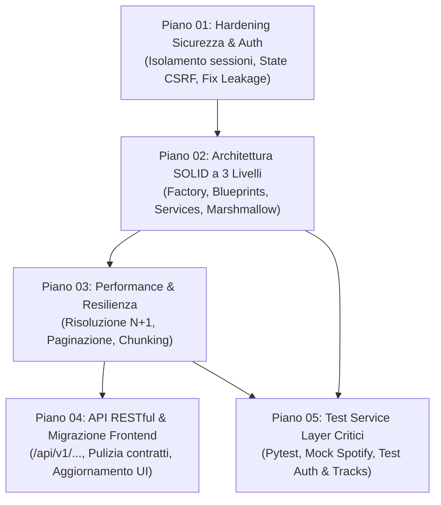

# Massive Refactoring Master Plan & Architecture Roadmap

Questo documento fornisce la panoramica esecutiva, la sequenza delle fasi e la matrice di dipendenza per il refactoring completo del backend dell'applicazione Spotify.

I piani sono stati suddivisi in **5 aree tematiche indipendenti ma progressive**, progettate per trasformare lo script monolitico iniziale in una solida architettura a 3 livelli conforme ai principi **SOLID**, con sicurezza di livello enterprise, API RESTful coerenti e performance scalabili.

---

## 🗺️ Mappa dei Piani di Refactoring

| # | Documento | Categoria | Focus Principale | Dipendenze |
|---|---|---|---|---|
| **01** | [`01_security_and_auth_hardening.md`](./01_security_and_auth_hardening.md) | **Sicurezza & Autenticazione** | Isolamento sessioni, eliminazione `.cache` condiviso, token anti-CSRF, rimozione leakage globale. | Nessuna (Critico immediato) |
| **02** | [`02_architecture_and_solid_refactor.md`](./02_architecture_and_solid_refactor.md) | **Architettura & SOLID** | Modularizzazione a 3 livelli, Application Factory, Blueprints, Service Layer, Schemi Marshmallow. | Piano 01 |
| **03** | [`03_performance_and_resilience.md`](./03_performance_and_resilience.md) | **Performance & Resilienza** | Risoluzione N+1 query, rimozione loop bloccanti, chunking batch Spotify, parsing difensivo. | Piano 02 |
| **04** | [`04_restful_api_and_frontend_migration.md`](./04_restful_api_and_frontend_migration.md) | **API Design & Frontend** | Ridisegno RESTful `/api/v1/...`, standardizzazione envelope JSON, migrazione `app.js` ed `edit.js`. | Piano 02, Piano 03 |
| **05** | [`05_testing_and_qa_strategy.md`](./05_testing_and_qa_strategy.md) | **Testing & QA** | Test unitari mirati con Pytest per i service layer critici (Auth e Track processing), mock Spotify. | Piano 02, Piano 03 |

---

## 🔄 Flusso di Esecuzione e Dipendenze



---

## 🏛️ Target Architecture (Stato Finale Desiderato)

La struttura finale del backend al termine dell'esecuzione dei piani sarà la seguente:

```
backend/
├── __init__.py               # Application Factory: create_app()
├── config.py                 # Configurazione tipizzata da variabili d'ambiente
├── run.py                    # Entrypoint WSGI (sviluppo/produzione)
├── auth/
│   ├── __init__.py
│   ├── oauth.py              # Handler SpotifyOAuth con FlaskSessionCacheHandler
│   └── decorators.py         # Decoratore @require_auth con Dependency Injection
├── services/
│   ├── __init__.py
│   ├── base.py               # Eccezioni e client factory
│   ├── auth_service.py       # Logica token, state e refresh
│   ├── playlist_service.py   # Gestione playlist, duplicati, chunking
│   └── track_service.py      # Estrazione difensiva, parsing e formattazione tracce
├── schemas/
│   ├── __init__.py
│   ├── common.py             # Schema risposte d'errore standard
│   └── playlist_schemas.py   # Validazione Marshmallow per payload di input
└── routes/
    ├── __init__.py
    ├── auth_bp.py            # /login, /callback, /logout
    ├── me_bp.py              # /api/v1/me, /api/v1/me/tracks
    └── playlists_bp.py       # /api/v1/playlists (CRUD RESTful)
```

---

## 📋 Regole Guida di Implementazione

1. **Priorità alla Sicurezza:** Nessuna nuova feature deve essere introdotta prima di aver risolto la persistenza condivisa dei token su `.cache` e il data-leakage globale tra utenti (Piano 01).
2. **Nessun Bypass di Validazione:** Ogni endpoint mutante deve convalidare i dati in ingresso tramite schemi Marshmallow dedicati prima di delegare l'esecuzione al service layer.
3. **Resilienza Terze Parti:** Tutte le interazioni con l'API Spotify devono essere gestite difensivamente, traducendo eccezioni remote (`SpotifyException`) in codici HTTP standard e messaggi comprensibili per il client.
4. **Isolamento dei Test:** I test del Service Layer (Piano 05) non devono mai eseguire chiamate di rete reali verso Spotify: devono usare mock e fixture controllate.
